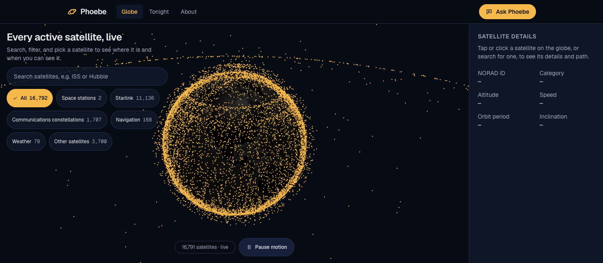
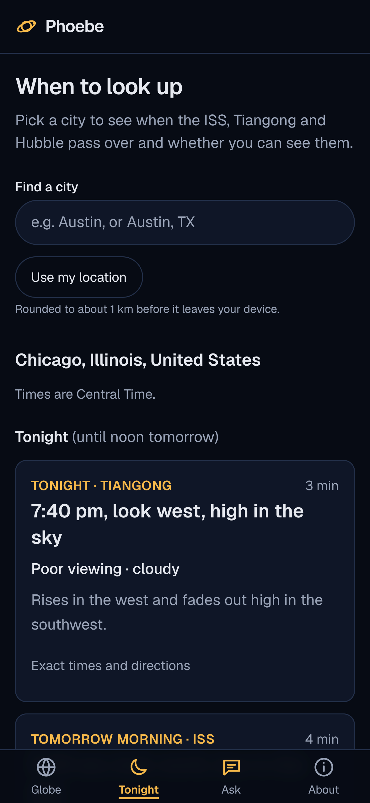
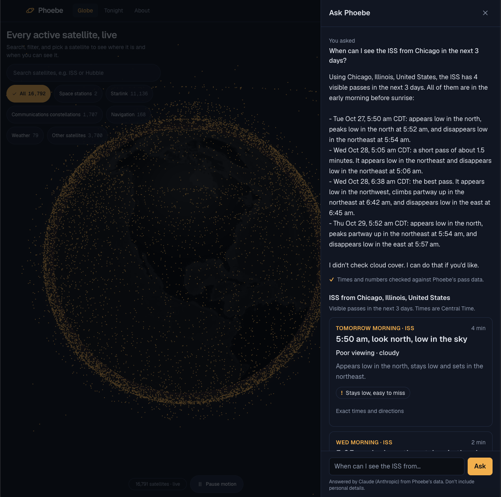
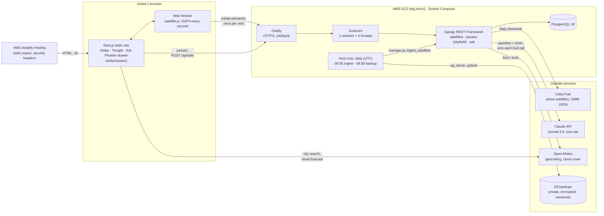
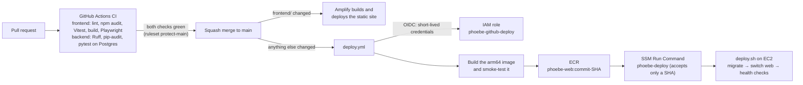
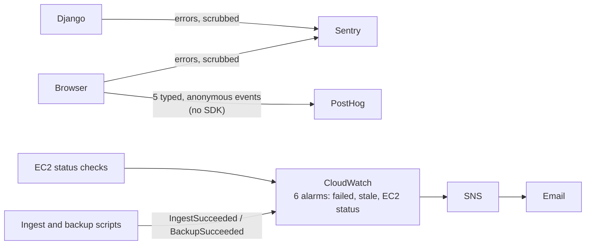

# Phoebe

**When should I go outside, and will I actually see it?**

Phoebe tracks about 16,800 active satellites live on a 3D globe and tells you when the bright ones (the ISS, China's Tiangong station, Hubble) will be visible from your city. Visible means the satellite is sunlit while your sky is dark. It rates each pass good, fair or poor from the cloud forecast. Ask Phoebe, an AI assistant, answers plain-English questions by calling Phoebe's own APIs as tools, and every time and number in its answer is checked against the tool data before it's shown.

**Live:** [phoebe.garickm.com](https://phoebe.garickm.com) · [Tonight](https://phoebe.garickm.com/tonight/) · [About](https://phoebe.garickm.com/about/) · API: [`/api/satellites/?search=ISS`](https://phoebe-api.garickm.com/api/satellites/?search=ISS)

Next.js · TypeScript · satellite.js · Django REST Framework · skyfield · PostgreSQL · Docker · AWS (EC2, Amplify, ECR, SSM, S3, CloudWatch) · GitHub Actions · Claude API

<p></p>

<table>
  <tr>
    <td width="34%"></td>
    <td></td>
  </tr>
  <tr>
    <td align="center">Tonight, on a phone</td>
    <td align="center">Ask Phoebe: a verified answer with its pass cards</td>
  </tr>
</table>

## What it does

- **Globe:** every active satellite from [CelesTrak](https://celestrak.org/), moving live. Search ("ISS", "Hubble"), filter by category, and click a satellite to see its altitude, speed, orbit and path over the ground.
- **Tonight:** pick a city to see the next 7 days of visible passes as cards ("8:14 pm, look northwest, high in the sky"), each with a viewing rating from the hourly cloud forecast. The exact times and degrees are behind a details toggle. It's built for phones, because that's what people check outside.
- **Ask Phoebe:** "When can I see the ISS from Chicago this week when it's clear?" Claude calls three read-only tools (pass predictions, satellite lookup, cloud forecast). The answer shows only after the browser has checked every time and number in it against those tool results. If a check fails, Phoebe hides the answer and shows the passes straight from the data.
- **Privacy:** no accounts. Locations are a city name or coordinates rounded to 2 decimals (about 1 km), rounded in the browser before they're sent anywhere, and never logged.

## Measured numbers

All measured on the live system or in its test suites. Dates are when each was measured.

| What | Result |
|---|---|
| Pass predictions vs [Heavens-Above](https://www.heavens-above.com/) (Chicago, Oct 20–26) | The same **11 visible ISS passes**, and **33 of 33** timed points (appears, highest, disappears) **within 2 s**, with matching compass directions |
| Visibility through the whole pass vs only at its peak (ISS, world grid, 1 week) | A peak-only check would have hidden **46%** of the passes that have a visible part |
| Browser (satellite.js) vs server (skyfield) positions, committed test | **26–44 m** apart on the ground, altitude identical (the gap is UT1−UTC) |
| Ask Phoebe evaluation, 20 questions, re-scored in CI on every PR | **Sonnet 5.5: 19/20 (95%)**; Opus 5.5: 17/20 on the same questions. Production uses Sonnet |
| Answer verification (`verifyAnswer()`) | **10 of 10** deliberately wrong answers caught (a time 1 minute off, a wrong weekday, a borrowed duration, …) |
| Tests run before every merge (Oct 22) | **252 pytest, 270 Vitest, 15 Playwright**; CI takes about 46 s |
| Lighthouse, Tonight, PageSpeed Insights mobile (Oct 26) | **100 / 100 / 100 / 100** (Performance, Accessibility, Best Practices, SEO); LCP 1.7 s on Slow 4G |
| Accessibility (WAVE, live site, Oct 26) | **0 errors and 0 contrast errors** on Globe, Tonight, About and the answered Ask Phoebe drawer; keyboard-only main flow and VoiceOver checked |
| Globe data | One request, **989 KB** compressed for about 16,700 satellites. SGP4 runs in a Web Worker, so the page spends about **1 ms** per update |
| Backups | Daily to S3; a restore was tested end to end, and row counts matched production exactly |
| Hosting cost | About **$12 a month** estimated at list prices (one t4g.micro, its IPv4 address, disk, Amplify) |

## Architecture

The browser animates the satellites, and the server does the accuracy-critical work. Streaming thousands of positions a second from a server would waste bandwidth, so the browser downloads each satellite's orbital elements once and runs SGP4 itself in a Web Worker. Django handles everything that has to be right: the daily data pipeline, pass predictions with visibility, search and Ask Phoebe. SGP4 runs in two places, so a committed test checks that the two sides agree.



**Ask Phoebe's loop:** Django sends the question and the tool definitions to Claude. Claude asks for a tool (for example `get_passes` for the ISS from Chicago for 3 days), Django runs it against its own code and data and sends back the result, and that repeats until Claude writes the answer (at most 4 rounds and 6 tool calls). The tools are read-only and return only public data. Spending has three limits: per-IP throttles, a daily dollar budget counted in Postgres, and a monthly limit in the Claude Console.

### Deploys

Every pull request runs both CI jobs, and `main` only accepts a squash merge once they're green. A merge then deploys with no manual steps. No AWS keys are stored anywhere, and the server has no SSH port.



`deploy.sh` runs the migrations in a throwaway container while the old one keeps serving, then switches. It keeps the previous image for a one-command rollback. Details are in [docs/operations.md](docs/operations.md#deploy-an-update).

### Monitoring



Nothing that identifies a visitor leaves the server or the browser: no query string, place name, question text or IP address. Tests fail if it does.

## Key decisions

Each decision was made with the alternatives written down. These are the highlights; the longer list, with the reasoning and what was rejected, is in [docs/decisions.md](docs/decisions.md).

1. **[The browser animates, the server computes.](docs/decisions.md#browser-animates-server-computes)** satellite.js runs in a Web Worker from one download of orbital elements, and skyfield on the server does pass predictions. A test keeps the two within 100 m.
2. **[One EC2 server with Docker Compose and Caddy](docs/decisions.md#one-server)** instead of ECS Fargate, a load balancer and RDS. That's about $12 a month instead of $30–50, and Caddy gives free HTTPS.
3. **[Visibility is checked through the whole pass, not just at its peak.](docs/decisions.md#visibility-through-the-whole-pass)** A peak-only check would hide 46% of the visible passes.
4. **[Tolerances set before checking against Heavens-Above.](docs/decisions.md#cross-check-with-tolerances-set-first)** The limit was 60 s, and every point landed within 2 s.
5. **[Ask Phoebe's numbers are verified before they're shown](docs/decisions.md#verify-before-showing)**, in the browser, next to the cards that replace a failed answer.
6. **[The evaluation is recorded once and replayed in CI](docs/decisions.md#evaluation-by-record-and-replay)**, so CI never calls Claude and costs $0 a run. A prompt fingerprint forces a new recording when the prompt or tools change.
7. **[Deploys go through OIDC and SSM, with a deploy command that accepts only a commit SHA](docs/decisions.md#oidc-and-ssm-deploys)**: no stored keys, no SSH and no arbitrary root commands.
8. **[Privacy by construction](docs/decisions.md#privacy-by-construction):** coordinates are rounded in the browser, query strings never reach the logs, and analytics events are typed so a place name can't be sent.

Security is covered in the threat model, [docs/security.md](docs/security.md).

## Run the back end locally

**You need:** Git and Docker Desktop (with Docker Compose v2). Python is optional, because everything runs in containers.

1. **Clone and create your settings file.** `.env` holds secrets and is gitignored. Never commit it.
   ```
   git clone https://github.com/garick-git/phoebe.git && cd phoebe
   cp .env.example .env
   ```
   In `.env`, replace both `change-me` values (`DJANGO_SECRET_KEY` and `POSTGRES_PASSWORD`) with random strings, for example from `openssl rand -hex 32`. The app refuses to start if a required secret is missing.

2. **Start the stack** (Postgres 18 and Django's development server). Leave this running in its own terminal tab; its logs stream there.
   ```
   docker compose up --build
   ```
   Use `--build` the first time and after `requirements.txt` or the `Dockerfile` changes; otherwise plain `docker compose up`.

3. **Create the tables and an admin login** (in a second tab):
   ```
   docker compose exec web python manage.py migrate
   docker compose exec web python manage.py createsuperuser
   ```

4. **Load satellite data** from CelesTrak's active-satellites feed:
   ```
   docker compose exec web python manage.py ingest_satellites
   ```
   CelesTrak asks for no more than a few downloads a day. For repeated local runs, keep a saved copy of the feed (OMM JSON) in `data/` (gitignored) and load that instead:
   ```
   docker compose exec web python manage.py ingest_satellites --file data/active.json
   ```

5. **Try it:**
   - Admin: http://127.0.0.1:8000/admin/
   - Search: http://127.0.0.1:8000/api/satellites/?search=ISS
   - Detail: http://127.0.0.1:8000/api/satellites/25544/
   - Current position: http://127.0.0.1:8000/api/satellites/25544/position/
   - Upcoming passes over a place (rise, peak and set above 10°, plus whether each pass is visible: satellite sunlit and Sun below −6°, with when it appears, its highest visible point and when it disappears, or why not; `lat` and `lon` required and rounded to 2 decimals, `days` 1–7, default 7): http://127.0.0.1:8000/api/satellites/25544/passes/?lat=30.27&lon=-97.74&days=7
   - Globe data (newest orbital elements for every current satellite, one unpaginated list): http://127.0.0.1:8000/api/satellites/elements/
   - Ask Phoebe (POST JSON; answers 503 "not switched on" unless `ANTHROPIC_API_KEY` is set in `.env`): `curl -s -X POST http://127.0.0.1:8000/api/ask/ -H "Content-Type: application/json" -d '{"question": "When can I see the ISS from Austin this week?"}' | python3 -m json.tool`

   The API is read-only and rate limited (60 requests a minute per client; Ask Phoebe also 5 a minute and 20 a day), locally too.

## Run the front end locally

**You need:** Node 24 (the version is pinned in `frontend/.nvmrc`; with nvm, run `nvm use` in `frontend/`).

```
cd frontend
nvm use
npm ci
npm run dev
```

The app runs at http://localhost:3000 and calls the local API at http://127.0.0.1:8000, so for that to work, add `DJANGO_CORS_ALLOWED_ORIGINS=http://localhost:3000` to `.env` and keep the back end running. Other commands: `npm run build` (static export into `frontend/out/`; it calls the production API), `npm run lint`.

The front end is a Next.js static export: `next build` writes plain HTML, CSS and JavaScript, and no Next.js server runs in production. Everything dynamic comes from the Django API, called from the browser.

## Tests

```
docker compose exec web pytest -v        # back end (needs the stack running)
cd frontend && npm test                  # Vitest: front-end logic and the Ask Phoebe evaluation
cd frontend && npm run build && npm run test:e2e   # Playwright, against the static export
```

pytest-django creates a separate test database for each run, so tests never touch your local data. A `No directory at: /app/staticfiles/` warning is expected locally and harmless (the dev bind mount hides the image's collected static files). Playwright needs its browser once: `npx playwright install --only-shell chromium`. No test calls the real Claude API.

## Notes

- Never run `docker compose down -v`: `-v` deletes the database volume.
- If `docker compose exec` says `service "web" is not running`, start the stack first (step 2).
- The production server uses `compose.prod.yaml` (Caddy, Gunicorn, Postgres), not `compose.yaml`. See [docs/operations.md](docs/operations.md).
- The front end is hosted on AWS Amplify; see [docs/operations.md](docs/operations.md#front-end-hosting-aws-amplify).

## Data sources and credits

Orbital data from [CelesTrak](https://celestrak.org/). Weather and city search from [Open-Meteo](https://open-meteo.com/) (city data from GeoNames, CC BY 4.0). The Earth texture comes from the [three-globe](https://github.com/vasturiano/three-globe) project (MIT). Full credits are on the [About page](https://phoebe.garickm.com/about/).
